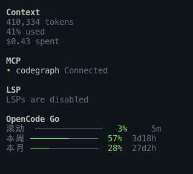
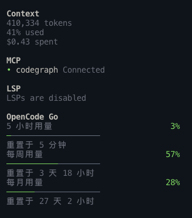
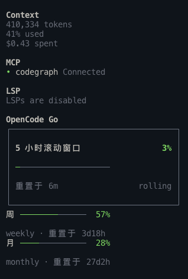

# opencode-go-usage

[中文](README.md) | **English**

Shows your remaining **OpenCode Go** quota in the sidebar of the [opencode](https://opencode.ai) terminal UI: the 5-hour rolling window, the week, and the month, each with how much is used and when it resets.

## Version compatibility

| Version | OpenCode | Notes |
|---|---|---|
| `v0.1.0` (tag) | 1.x (≥1.18.30) | Only supports the OpenCode V1 TUI plugin API; frozen. See the README inside that tag for install steps |
| `v0.2.x` (main) | 2.x (≥2.1.2) | Uses the OpenCode V2 `@opencode/plugin/tui` API; this document describes this version |

OpenCode V2 does not read the V1 `tui.json` plugin entry, and V1 does not read V2 `cli.json`. Check the plugin version before upgrading OpenCode.

<table>
  <tr>
    <th>compact (default)</th>
    <th>detailed</th>
    <th>ledger</th>
  </tr>
  <tr valign="top">
    <td></td>
    <td></td>
    <td></td>
  </tr>
</table>

> The on-screen labels are in Chinese: 滚动 = rolling 5-hour window, 本周 = this week, 本月 = this month, 重置于 = resets in.

## Why

OpenCode Go rate-limits you on three windows: a 5-hour rolling window, a week, and a month. The opencode terminal UI doesn't show how much you've used. You have to check the web console, and you usually find out you're out of quota when a request gets throttled.

This plugin puts all three windows in the sidebar, after the built-in `Context` / `MCP` / `LSP` sections. You see them while you work. The bar turns yellow past 70% and red past 90%.

## Features

- **Zero config**: reuses the key opencode saved when you ran `opencode auth login`
- **Three styles**: pick a default in the config, or switch for the current session with a slash command
- **Follows your theme**: every color comes from the active opencode theme, so dark and light themes both work
- **Light on requests**: refreshes only after the assistant finishes a reply (at most once every 20 seconds), plus a 5-minute fallback; the countdown is computed locally
- **Quiet on failure**: without a Go subscription or a key, the section stays hidden; on a network hiccup it keeps the last numbers and adds a `!` to the title

## Quick start

**You need**: OpenCode ≥ 2.1.2, [bun](https://bun.sh), and an active OpenCode Go subscription (logged in with `opencode auth login`).

**1. Clone and install dependencies**

```bash
git clone https://github.com/hugo2046/opencode-go-usage.git
cd opencode-go-usage
bun install
echo "$PWD"   # note this repo directory's absolute path, you'll need it next
```

**2. Register the plugin**

Edit `~/.config/opencode/cli.json` (the global OpenCode V2 terminal client config; there is no project-local equivalent):

```json
{
  "$schema": "https://opencode.ai/v2/cli.json",
  "plugins": ["<the absolute path printed above>"]
}
```

If you already have a `cli.json`, append the path to the `plugins` array and keep your existing `theme`, `session`, and other plugins.

**3. Restart opencode**

An `OpenCode Go` section appears after the built-in sidebar sections. V2's `sidebar.content` can only append; it cannot be inserted between built-in sections.

**Don't see it?** The section stays hidden, with no error, in four cases: no key, no subscription, an invalid key, or the plugin didn't load. The [troubleshooting guide](docs/排障指南_20260916.md#先跑这一条数据层诊断) (Chinese) has one command that tells you which.

## Configuration

Change the plugin entry in `cli.json` from a string to an object:

```json
{
  "$schema": "https://opencode.ai/v2/cli.json",
  "plugins": [
    {
      "package": "<absolute repo path>",
      "options": { "style": "ledger" }
    }
  ]
}
```

| Field | Values | Default | Meaning |
|---|---|---|---|
| `style` | `"compact"` \| `"detailed"` \| `"ledger"` | `"compact"` | Style used at startup |

**Restart opencode** after editing; `cli.json` is read only at client startup. Invalid values don't raise an error, they silently fall back to the defaults.

V2 removed the V1 `order` option: `sidebar.content` has no ordering, so the section is always appended after the built-in sections.

### Styles

| Style | Height | What it's for | Switch command |
|---|---|---|---|
| `compact` | Shortest | One line per window, for a quick glance | `/go-usage-compact` |
| `detailed` | Medium | Three lines per window, with the full reset countdown | `/go-usage-detailed` |
| `ledger` | Tallest | The 5-hour window in a bordered main panel, week and month as secondary rows | `/go-usage-ledger` |

Slash commands only change the current session; after a restart you're back to the style set in `cli.json`. If your opencode version can't register commands, the sidebar still works, you just can't switch by command.

For screenshots and how to check dark and light themes, see the [style guide](docs/OpenCodeGo样式切换指南_20260917.md) (Chinese).

## How it works

**Data source**: `GET https://opencode.ai/zen/go/v1/usage`, authenticated with `Authorization: Bearer <key>`. It's opencode's own endpoint, but it isn't in the public docs.

**Key lookup**, in this order. The plugin never stores its own copy:

1. The `OPENCODE_GO_API_KEY` environment variable
2. `opencode-go.key` in `auth.json` inside opencode's data directory (on macOS / Linux, `~/.local/share/opencode` by default)

**When it refreshes**:

| Trigger | What happens |
|---|---|
| Plugin starts | Fetches right away |
| Assistant finishes a reply | Fetches, unless the last request was under 20 seconds ago |
| Every 5 minutes | Fallback fetch, in case quota was used elsewhere |
| Every 60 seconds | Recomputes the countdown locally, no request |

**When something goes wrong**:

| Situation | What the sidebar shows |
|---|---|
| No Go subscription, or invalid key (401 / 403) | Section hidden, and no further requests |
| No key found | Section hidden; each refresh looks for the key again |
| Network error, timeout (15 seconds), server 5xx | Keeps the last numbers; title becomes `OpenCode Go !` |

## Known limitations

- **Whole-number percentages only**: the endpoint returns integers. The one decimal place in the web console (like `8.1%`) comes from a different data path the plugin can't reach.
- **No absolute usage**: the endpoint gives percentages and reset times, not token counts or cost.
- **Relies on an undocumented endpoint**: if opencode changes it, the plugin may break.
- **Tested only on OpenCode 2.1.2**: the V2 CLI plugin API may still change between releases; re-check the sidebar and commands after upgrading OpenCode.
- **The sidebar position is fixed after the built-in sections**: V2's `sidebar.content` only supports append/prepend, so it cannot sit between `LSP` and `Todo`.

## Documentation

All docs are in Chinese.

| Doc | Covers |
|---|---|
| [Install guide](docs/安装指南_20260916.md) | From zero to seeing your quota in three steps |
| [Style guide](docs/OpenCodeGo样式切换指南_20260917.md) | Config, commands, screenshots, dark and light theme checks |
| [Troubleshooting](docs/排障指南_20260916.md) | Section missing, wrong position, numbers not updating |
| [Config and behavior reference](docs/配置与行为契约_20260916.md) | Exact definitions of every constant, format, and failure case |
| [Manual verification checklist](docs/OpenCodeGo额度侧栏_手工验证清单_20260916.md) | Items that need a human to confirm |
| [Design spec (V2 migration)](docs/superpowers/specs/2026-10-22-opencode-v2-migration-design.md) | Background, API mapping, and delivery order for the V2 migration |
| [Design spec (V1, historical)](docs/superpowers/specs/OpenCodeGo额度侧栏_20260916.md) | The original v0.1.0 design, including research findings and explicit non-goals |

## Development

```
usage.ts      Pure logic: key lookup, API request, refresh state machine, formatting (no terminal UI dependency)
tui.tsx       Terminal UI: sidebar rendering, style switching, slash command registration
tests/        bun test suites
docs/         Documentation
```

```bash
bun test              # run tests
bunx tsc --noEmit     # type check
```

`usage.ts` has no terminal UI dependency and is fully unit tested. `tui.tsx` uses `@opencode/plugin/tui`'s `Plugin.define({ id, setup })`; `@opentui/*` and `solid-js` are provided by the OpenCode runtime, and the local install is only for type checking and tests. The tests use a V2 fake context to cover slots, commands, and style switching.

## Uninstall

Remove this plugin's entry from the `plugins` array in `~/.config/opencode/cli.json` (or delete the whole file if this plugin is the only entry), then restart opencode. This plugin never touches your `opencode.json`.

## License

[MIT](LICENSE)
